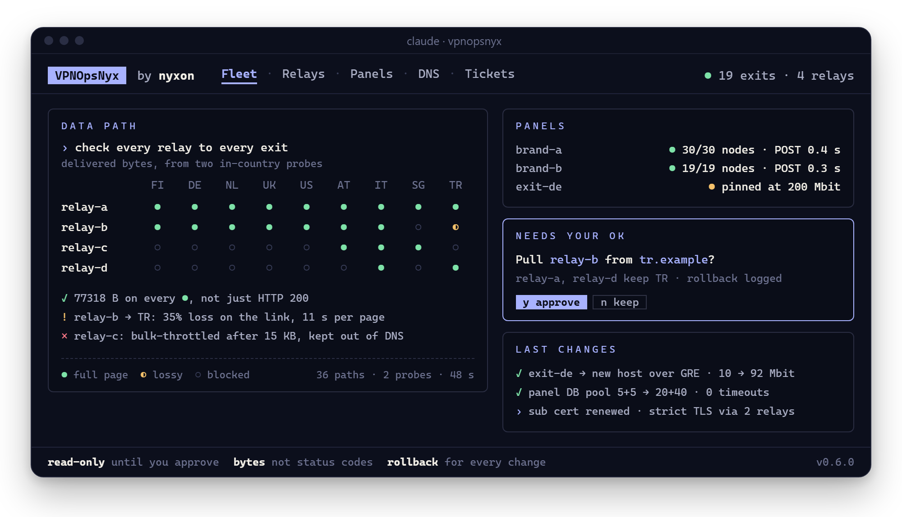
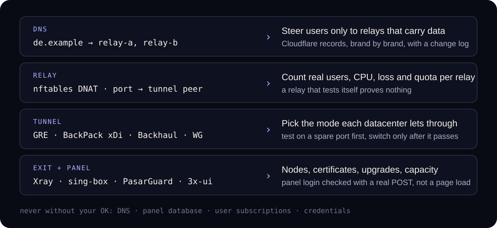

<p align="center">
  
</p>

<h1 align="center">VPNOpsNyx</h1>

<p align="center">
  Навык оператора, с которым Claude, Codex и другие ИИ-агенты управляют парком VPN:<br>
  панели, ноды, туннели, реле и DNS — проверка реальными байтами и изменения только с вашего согласия.
</p>

<p align="center">
  <a href="https://github.com/nyxon-tech/vpnopsnyx/actions/workflows/quality.yml"></a>
  
  
  <a href="./LICENSE"></a>
</p>

<p align="center">
  <a href="README.md">English</a> · <a href="README.fa.md">فارسی</a> · <b>Русский</b> · <a href="README.zh-CN.md">简体中文</a>
</p>

Парк VPN ломается так, что никакая страница статуса этого не покажет. Реле отвечает `200` и замирает после 15 КБ. Туннель пингуется и не пропускает ничего. Дата-центр меняет ваш IP, и все режимы, работавшие вчера, пропадают. Выход упирается в лимит 200 Мбит, и никто не замечает, пока не начнут жаловаться пользователи.

**VPNOpsNyx** даёт вашему ИИ-агенту тот опыт, который опытный оператор держит в голове. Агент осматривает парк, измеряет каждый путь реле–выход доставленными байтами с проб внутри страны, находит причину, предлагает исправление вместе со способом отката и ждёт вас, прежде чем трогать DNS, панель или туннель. Это не VPN, не туннель и не форк панели: это Markdown, JSON и небольшие shell-скрипты, которые может прочитать любой агент.

## Установка

**Claude Code**

```sh
git clone https://github.com/nyxon-tech/vpnopsnyx ~/.claude/skills/vpnopsnyx
```

**Codex**

```sh
git clone https://github.com/nyxon-tech/vpnopsnyx ~/.codex/skills/vpnopsnyx
```

**Любой другой агент:** склонируйте репозиторий в папку навыков или плагинов агента и укажите ему [`SKILL.md`](SKILL.md). Всё остальное — обычные Markdown и JSON, их читает любая среда. См. [docs/agent-compatibility.md](docs/agent-compatibility.md).

Дальше просто попросите, на любом языке:

```text
проверь все серверы обоих брендов
панель не открывается из Ирана, найди причину
перенеси Германию на мой новый сервер Hetzner
убери из DNS реле, которое постоянно отваливается
напиши тикет в дата-центр о потере пакетов
```

## Что он знает

| | |
| --- | --- |
| **Панели** | PasarGuard, 3x-ui / Sanaei, Marzban, Marzneshin, Hiddify, Remnawave, S-UI: ноды, сертификаты, обновления, пулы соединений БД, блокировка входов. |
| **Ядра** | Xray-core, sing-box, WireGuard, AmneziaWG, Hysteria2, TUIC, VLESS / VMess / Trojan, Shadowsocks, Reality и TLS. |
| **Туннели** | GRE, [BackPack](https://github.com/AminMGMT/BackPack) xDi (прямой и обратный), Backhaul, Rathole, Paqet, FRP, DaggerConnect, SIT / 6to4, реле WireGuard. |
| **Реле** | DNAT на nftables с пробным прогоном и откатом, реальные пользователи по реле, MSS clamping, квоты и ёмкость, разделение брендов. |
| **DNS** | Записи Cloudflare по локациям и брендам, переключение и возврат, журнал каждого изменения. |
| **Фильтрация в Иране** | Ограничение объёмного трафика, «чёрные дыры» для входящих из-за рубежа, GRE в зависимости от дата-центра, чёрные списки IP, исчерпание квоты, похожее на аварию. |
| **Эксплуатация** | Снимки состояния, матрицы путей данных, миграции, безопасные обновления и перезагрузки, разбор инцидентов, тикеты провайдерам. |

## Как это работает

<p align="center">
  
</p>

- **Измеряйте байты, а не коды ответа.** Каждый путь проверяется тем, сколько данных реально пришло (полная тестовая страница, а не просто `HTTP 200`), с проб в другом дата-центре. Реле, проверяющее само себя, ничего не доказывает.
- **Две пробы перед любым изменением DNS.** Одна точка измерения может сломаться сама по себе. Навык переводит пользователей только тогда, когда согласны две пробы внутри страны.
- **Сначала запасной порт, потом переключение.** Новый туннель строится и измеряется рядом с рабочим; рабочий порт переносится только после того, как новый путь прошёл проверку, а старый остаётся для отката.
- **Только чтение до вашего одобрения.** Агент никогда не печатает и не сохраняет пароли, ключи, токены туннелей и ссылки подписок и записывает, как отменить каждое изменение.

<details>
<summary><b>Полевые уроки, октябрь 2026</b></summary>

Обезличенные наблюдения (`operator-observed`) в парке из двух брендов с несколькими иранскими дата-центрами реле:

1. **Постоянные GRE-линки реле.** Обычный GRE с DNAT пропускал пользователей там, где TCP DNAT и xDi не работали, почти без нагрузки на CPU и без лимита линков на выход; некоторые дата-центры его блокируют. `scripts/relay/greunit.sh`, `references/tunnels.md` §16.
2. **Реле с новым IP — это новое реле.** В новом диапазоне GRE и объёмный TCP перестали работать, оставался только xDi с набором со стороны выхода, затем пропал и он. Перемерьте все режимы и не делайте такое реле единственным для локации. `references/tunnels.md` §17.
3. **Один исходящий xDi-линк на выход — подтверждено снова.** Второй линк проходил первый тест и умирал через минуты на четырёх выходах. У выхода, общего для двух брендов, один такой линк на всех. `references/tunnels.md` §15.
4. **Не ставьте xDi-реле за домен панели и подписок.** Чтение работало, но тела `POST`/`PUT` зависали ~16 минут, и продления через бота не проходили. Проверяйте `POST` через каждый адрес. `references/pasarguard.md` §16.
5. **Мёртвые линки продолжают есть CPU.** Отключайте их с обеих сторон сразу после подтверждения.
6. **Следите за неудачными входами в панель и блокируйте осознанно.** `scripts/panel/auth_failures.sh`, `scripts/panel/blocklist.sh`, `references/pasarguard.md` §17.
7. **Проверяйте разделение брендов и в DNS, и на реле.** `scripts/local/dns_brand_audit.sh` для записей, `scripts/relay/forward_audit.sh` для пробрасываемых портов.
8. **Проверяйте домен подписок через каждый адрес и реальной загрузкой.** Прямой IP панели отвечал на вход, но загрузка 200 КБ зависала из большинства дата-центров страны. `scripts/relay/panel_path_check.sh`, `references/pasarguard.md` §16.
9. **Не оставляйте DNS-имя пустым.** Резолверы кэшируют NXDOMAIN до 30 минут. `references/cloudflare.md`.
10. **Inbound без группы не получает никто.** `scripts/panel/inbound_groups.py`; добавление туннельного inbound, хоста и групп через API — `references/pasarguard.md` §18.
11. **Диапазоны IP реле различаются, квоты заканчиваются, у выходов бывает лимит исходящего канала.** Просите другой диапазон, если новый провалил все тесты; проверяйте квоту, если реле работает только изнутри страны. `references/tunnels.md` §17, `references/iran-filtering.md` §5.
12. **Два сервиса на одном порту 443** через SNI-маршрутизатор nginx: `references/tunnels.md` §18.
13. **Не убирайте реле по данным одной точки.** Отказало соединение самого оператора, а около 1500 пользователей спокойно работали через это реле. Подтверждайте с двух проб внутри страны и со стороны выхода. `references/cloudflare.md` §4.
14. **В Иране держите панель вне прокси Cloudflare.** Резолверы отдавали для проксируемых имён два медленных адреса; выведите порт панели через GRE-реле, получите сертификат на имя и только потом переключайте на DNS only. `references/pasarguard.md` §20.
15. **Увеличьте пул соединений БД в PasarGuard.** Значение по умолчанию 5+5 давало случайные сбои панели; 20+40 и пересоздание контейнера их устранили. `references/pasarguard.md` §19.
16. **Переносите выход с ограничением сначала через запасной порт.** После проверки перенаправьте DNAT одного реле, не очищая conntrack, — пользователи перетекут без обрыва. `references/node-lifecycle.md` §12.

Подробнее в [docs/field-observations-2026-10.md](docs/field-observations-2026-10.md).

</details>

<details>
<summary><b>Что лежит в репозитории</b></summary>

| Путь | Содержимое |
| --- | --- |
| [`SKILL.md`](SKILL.md) | Точка входа агента: правила безопасности, порядок диагностики, маршрутизация по справочникам. |
| [`scripts/`](scripts/README.md) | Проверенные в работе скрипты: реальные пользователи по реле, состояние, матрица тестов xDi, проверенный DNAT, GRE-линки, правка нод и сертификатов PasarGuard, DNS в Cloudflare и аудит брендов. |
| [`references/`](references/README.md) | Архитектура, панели, туннели, Cloudflare, инциденты, ёмкость, фильтрация в Иране, жизненный цикл нод. |
| [`guides/panels/`](guides/panels/README.md) · [`guides/tunnels/`](guides/tunnels/README.md) | Руководства по каждой крупной панели и семейству туннелей. |
| [`registries/`](registries/) | JSON-реестры панелей, ядер, туннелей, инструментов и проверенных репозиториев сообщества. |
| [`docs/`](docs/) | Рецепты установки и сети, гид по экосистеме, журнал источников, полевые наблюдения, сопровождение и условия релиза. |
| [`templates/fleet-inventory.example.md`](templates/fleet-inventory.example.md) | Шаблон приватной инвентаризации. Никогда не коммитьте заполненную копию. |
| `metadata.json` · `agents/openai.yaml` | Метаданные пакета для сред кроме Claude и для Codex. |
| `.github/workflows/` | Проверки структуры, JSON, ссылок, шаблонов секретов и ежемесячный обзор источников. |

</details>

<details>
<summary><b>Вопросы</b></summary>

**Агент будет менять мои серверы сам?** Нет. До одобрения конкретного изменения он только читает, и каждое изменение идёт вместе со способом отката. DNS, база панели, подписки и учётные данные без вашего согласия не трогаются.

**Есть ли в репозитории IP, ключи или ссылки подписок?** Нет. В нём нет секретов, учётных данных, API-токенов, приватных ключей и реальных инвентаризаций, а CI проверяет каждый коммит на шаблоны секретов. Держите свою инвентаризацию в секрете.

**Безопасно ли запускать команды установки?** Отметку `verified` имеют только команды, сверенные с публичными первоисточниками. Сторонние установщики и скрипты сообщества помечены соответственно и считаются удалённым выполнением кода: агент просматривает их перед запуском.

**С какими агентами он работает?** Claude Code и Codex — сразу. Любой агент, который читает Markdown и выполняет shell-команды, может использовать его через `SKILL.md`.

</details>

## Сообщество

VPNOpsNyx опирается на открытую работу мейнтейнеров, которые поддерживают инструменты для VPN, прокси, маршрутизации и обхода цензуры. Их репозитории легли в основу реестра сообщества и проверки источников:

[erfjabplus](https://github.com/erfjabplus) · [AsanFillter](https://github.com/AsanFillter) · [rezazoom](https://github.com/rezazoom) · [azavaxhuman](https://github.com/azavaxhuman) · [ircfspace](https://github.com/ircfspace) · [primeZdev](https://github.com/primeZdev) · [ppouria](https://github.com/ppouria) · [MHSanaei](https://github.com/MHSanaei)

А также панели, туннели и инструменты, на которые ссылается проект:

[Azumi67](https://github.com/Azumi67) · [PasarGuard](https://github.com/PasarGuard) · [vpaneladmin](https://github.com/vpaneladmin) · [Gozargah](https://github.com/Gozargah) · [marzneshin](https://github.com/marzneshin) · [hiddify](https://github.com/hiddify) · [remnawave](https://github.com/remnawave) · [alireza0](https://github.com/alireza0) · [Musixal](https://github.com/Musixal) · [behzadea12](https://github.com/behzadea12) · [opiran-club](https://github.com/opiran-club) · [itsFLoKi](https://github.com/itsFLoKi) · [AminMGMT](https://github.com/AminMGMT)

Упоминание — это благодарность и указание источника, а не оценка безопасности. Заметки по каждому репозиторию — в [docs/community-review.md](docs/community-review.md).

## Участие

Приветствуются новые панели и туннели, проверенные шаги установки, более безопасные откаты, случаи диагностики, исправления источников и переводы. Сделайте форк, внесите изменение в отдельной ветке со ссылками на авторитетные источники и откройте pull request в `nyxon-tech/vpnopsnyx`. Сначала прочитайте [CONTRIBUTING.md](CONTRIBUTING.md) и никогда не добавляйте учётные данные, приватные ключи, ссылки подписок, реальные IP или данные пользователей.

Лицензия MIT. Неофициальный проект, не связан ни с одной панелью, туннелем или VPN-проектом, которые он описывает.

<p align="center">
  <a href="https://github.com/nyxon-tech"></a>
</p>
